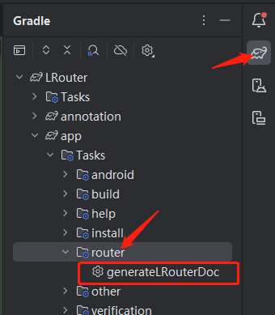

# LRouter

[中文文档](./README_ZH.md)

[](https://jitpack.io/#aleyn97/router)


LRouter is an Android router for modularized projects, built for modern Android toolchains.

It focuses on four practical goals:

- routing between pages and modules
- parameter passing and injection
- module-level initialization
- lightweight decoupling through simple DI

LRouter was created as a modern alternative to ARouter for projects running on recent AGP and Gradle versions.

## Why LRouter

ARouter helped a lot of Android modularization projects, but it has become harder to use in modern environments:

- AGP 8+ removed `Transform`, which breaks the old plugin-based approach.
- Dex scanning at startup is expensive if you do not use compile-time registration.
- ARouter is built around Java annotation processing, which is less friendly to Kotlin-first projects.
- Kotlin projects benefit much more from `KSP` than from `KAPT`.

LRouter keeps the mental model familiar for ARouter users, while updating the implementation strategy for modern Android builds.

## Highlights

- ARouter-like API surface for lower migration cost
- KSP-based code generation
- Optional ASM-based auto-registration for release builds
- Activity and Fragment routing
- `@Autowired` parameter injection
- interceptor support with stable priority ordering
- per-module initializer support
- simple DI for cross-module decoupling
- route table export task

## Compatibility

Minimum requirements:

- AGP 7.4+
- Gradle 8+
- JDK 17
- Kotlin project with KSP enabled

Environment verified in this repository:

- AGP `8.13.2`
- Gradle `8.13`
- JDK `17`
- Kotlin `2.3.20`
- KSP `2.3.6`

Notes:

- `debug` uses `ServiceLoader` by default for a better incremental build experience.
- `release` can optionally enable `ASM` registration to reduce runtime initialization cost.
- Every Android module that uses LRouter must apply the `aleyn-router` plugin.

## Installation

Add JitPack in `settings.gradle`:

```groovy
dependencyResolutionManagement {
    repositoriesMode.set(RepositoriesMode.FAIL_ON_PROJECT_REPOS)
    repositories {
        ...
        maven { url "https://jitpack.io" }
    }
}
```

Add the plugin dependency in the root `build.gradle`:

```groovy
buildscript {
    dependencies {
        classpath com.github.aleyn97.router:plugin:last-version
    }
}

plugins {
    // ...
    id 'com.google.devtools.ksp' version "x.y.z-x.y.z"
}
```

Apply the plugin in every module that uses LRouter:

```groovy
plugins {
    // ...
    id 'aleyn-router'
}
```

The plugin adds the core runtime and KSP processor automatically.

## Initialization Modes

LRouter supports two registration modes:

- `ServiceLoader`
  Best for development. Keeps incremental builds friendly. It uses a small amount of reflection internally.
- `ASM`
  Uses bytecode instrumentation for auto-registration. Better for release builds, but not ideal for incremental development.

Typical setup:

```groovy
buildTypes {
    release {
        minifyEnabled false
        proguardFiles getDefaultProguardFile('proguard-android-optimize.txt'), 'proguard-rules.pro'
        routerConfig { openASM = true }
    }

    debug {
        minifyEnabled false
        // routerConfig { openASM = false }
    }
}
```

## Quick Example

Annotate an `Activity` or `Fragment`:

```kotlin
@Route(path = "/Main/Main")
class MainActivity : BaseActivity()

@Route(path = "/Main/Home")
class MainFragment : BaseFragment()
```

Navigate:

```kotlin
LRouter.navigator("/Main/Home")
```

That is enough for a basic route.

## Basic Usage

### Parameter Injection

Call `LRouter.inject(this)` in your base activity:

```kotlin
abstract class BaseActivity : AppCompatActivity() {

    override fun onCreate(savedInstanceState: Bundle?) {
        super.onCreate(savedInstanceState)
        LRouter.inject(this)
    }
}
```

Pass parameters:

```kotlin
LRouter.build("/Main/Main")
    .withString("nickname", "Aleyn")
    .withInt("age", 18)
    .withAny("userInfo", UserInfo(/* ... */))
    .navigation()

// When using ActivityResultLauncher, pass a Context explicitly
LRouter.build("/Main/Main")
    .withActivityLaunch(activityLaunch)
    .navigation(this)
// Fragment: .navigation(requireContext())
```

Inject them with `@Autowired`:

```kotlin
@Route(path = "/Main/Main")
class MainActivity : BaseActivity() {

    @Autowired("nickname")
    var name = ""

    @Autowired
    var age = 0

    @Autowired
    lateinit var userInfo: UserInfo
}
```

Primitive values, `String`, and serializable objects are stored directly in `Bundle`.
Other objects, plus collections such as `List` and `Map`, are passed as JSON and parsed back using the declared type. Generic collections and nested objects are supported.

### Getting a Fragment

```kotlin
LRouter.build("/Main/Home").getFragment()
// or
LRouter.build("/Main/Home").asFragment<Fragment>()
```

### Navigation Callbacks

Listen to multiple navigation events:

```kotlin
LRouter.build("/Main/Home").navCallback(
    onInterrupt = {},
    onLost = {},
    onFound = {},
    onArrival = {},
)
```

Or use focused callbacks:

```kotlin
LRouter.build("/Main/Home").navInterrupt {
    // navigation interrupted
}

LRouter.build("/Main/Home").navFound {
    // route found
}

LRouter.build("/Main/Home").navLost {
    // route missing
}

LRouter.build("/Main/Home").navArrival {
    // navigation succeeded
}
```

Global callback:

```kotlin
LRouter.setNavCallback(object : NavCallback {
    override fun onLost(navigator: Navigator) {
        Log.d(TAG, "onLost: ${navigator.path}")
    }

    override fun onFound(navigator: Navigator) {
        Log.d(TAG, "onFound: ${navigator.path}")
    }

    override fun onArrival(navigator: Navigator) {
        Log.d(TAG, "onArrival: ${navigator.path}")
    }

    override fun onInterrupt(navigator: Navigator) {
        Log.d(TAG, "onInterrupt: ${navigator.path}")
    }
})
```

Per-route callbacks override the global one.

### Interceptors

Interceptors support priority. The default is `0`; larger values run earlier.

```kotlin
@Interceptor
class RoomInterceptor : LRouterInterceptor {

    override fun intercept(navigator: Navigator): Navigator {
        if (navigator.path == "/Room/Home") {
            return navigator.newBuilder()
                .replaceUrl("/First/Home")
                .build()
        }
        return navigator
    }
}
```

Return `null` to interrupt navigation completely.

### Module Initialization

LRouter supports per-module initialization, similar in spirit to `androidx.startup`, but without forcing all initialization wiring into the main app module.

```kotlin
@Initializer(priority = 1, async = false)
class AppModelInit : LRouterInitializer {

    override fun create(context: Context) {
        Log.d("AppModelInit", "create: AppModelInit")
    }
}
```

If one module must wait for another to finish initialization, make sure both initializers run on the same execution mode, either both sync or both async.

### Dependency Injection

LRouter includes a lightweight DI mechanism for cross-module decoupling. It is intentionally simple. If your project needs a more full-featured DI framework, you can still use `Dagger`, `Hilt`, `Koin`, or another dedicated solution.

Main annotations:

- `@Singleton`
- `@Factory`
- `@Qualifier`
- `@InParam`

Example:

```kotlin
@Singleton
class AppProviderImpl : IAppProvider {

    private var count = 0

    override fun getAppInfo(): String {
        count++
        return "this is APP Provider $count"
    }
}
```

Usage:

```kotlin
class YouActivity : BaseActivity() {

    @Autowired
    lateinit var appProvider: IAppProvider

    private val appProvider2 by inject<IAppProvider>()

    private val roomProvider by inject<IRoomProvider>(sq("room1"))
    private val roomProvider2 by inject<IRoomProvider>(sq("room2"))
}

@Qualifier("room1")
@Singleton
class RoomProviderImpl : IRoomProvider {
    override fun getRoomName(): String = "this is APP Provider 1"
}

@Qualifier("room2")
@Singleton
class RoomProviderImpl2 : IRoomProvider {
    override fun getRoomName(): String = "this is APP Provider 2"
}
```

### Action

Register an action:

```kotlin
@Route(path = "custom://action/test")
class TestAction : LRouterAction {
    override fun action(context: Context, arguments: Bundle) {
        val game = arguments.getString("Game").orEmpty()
        val role = arguments.getInt("role")

        Toast.makeText(context, "TestAction${game},${role}", Toast.LENGTH_SHORT).show()
    }
}
```

Execute it:

```kotlin
LRouter.build("custom://action/test")
    .withString("game", "CF")
    .withInt("role", 1002)
    .navigation()

// or
LRouter.navigator("custom://action/test?game=CF&role=1002")
```

### Generate Route Table

LRouter provides a dedicated Gradle task to export the route table:



The generated files are written to the main project's `build/router` directory.

## Migrating From ARouter

LRouter keeps the overall experience intentionally familiar for ARouter users.

Migration checklist:

- move from `KAPT` to `KSP`
- apply `aleyn-router` in every module that uses the router
- use `ServiceLoader` in development and optionally enable `ASM` in release
- for non-serializable objects and collections, rely on JSON-based parameter passing

LRouter is designed to replace ARouter in projects that have moved to newer AGP versions and can no longer depend on the old `Transform`-based integration model.

## Optional Configuration

### Disable Automatic Dependencies

If you do not want the plugin to add dependencies automatically, set this in `gradle.properties`:

```groovy
LRouter.auto = false
```

Then add dependencies manually:

```groovy
implementation 'com.github.aleyn97.router:core:last-version'
ksp 'com.github.aleyn97.router:processor:last-version'
```

### Apply the Plugin Automatically for Many Modules

If your project has many modules, you may prefer to apply the plugin from the root build file:

```groovy
subprojects.forEach {
    it.afterEvaluate {
        def isAndroid = (it.plugins.hasPlugin('com.android.application')
                || it.plugins.hasPlugin('com.android.library'))
        def isModule = it.name.startsWith('module') || it.name.startsWith('app')
        if (isAndroid && isModule) {
            it.plugins.apply('aleyn-router')
        }
    }
}
```

Adjust the matching rule to fit your own module naming convention.
